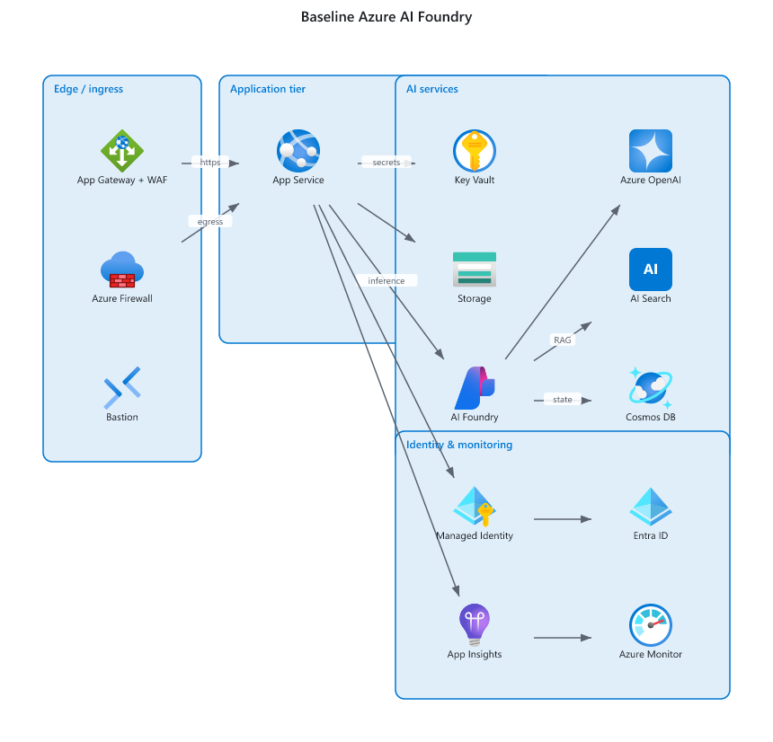
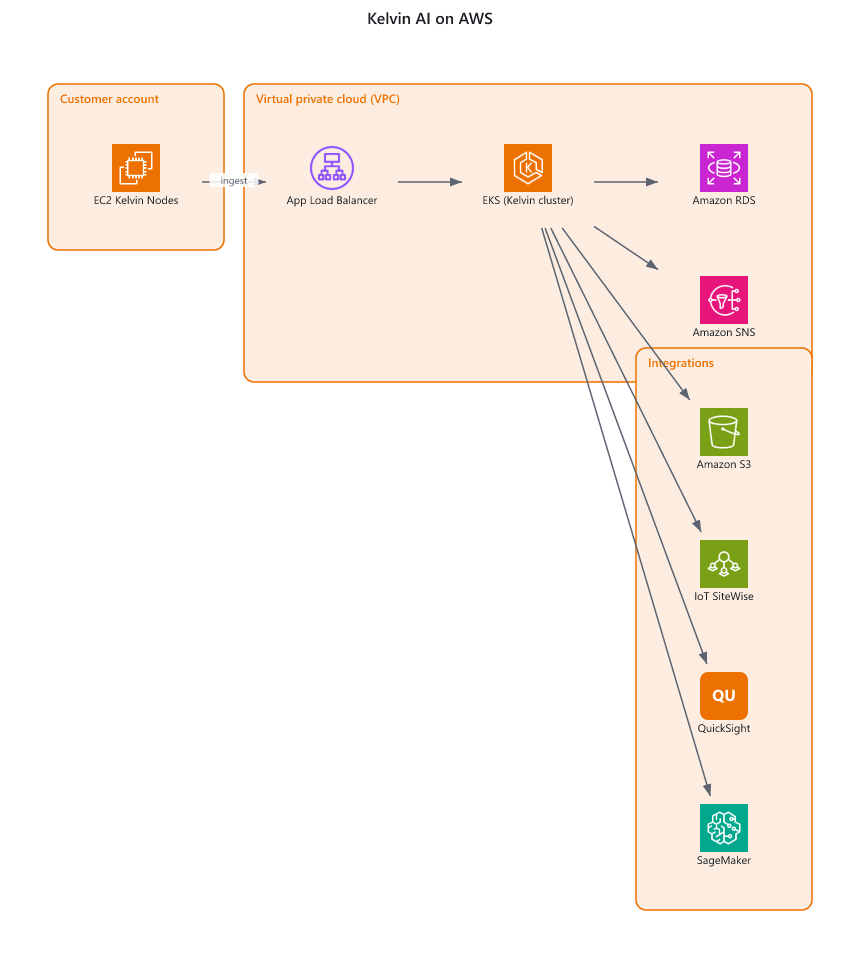
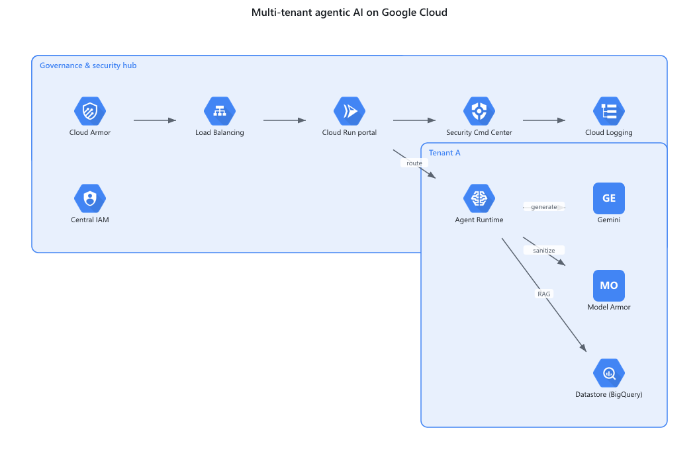

# archdiagram

[](https://github.com/bharathgnana/archdiagram/actions/workflows/ci.yml)
[](LICENSE)
[](https://www.python.org/)

Turn an architecture or workflow description into an **editable diagram**. Cloud service nodes use
official vendor icons (Azure App Service, AKS, Key Vault, S3, GKE, ...). Workflow nodes can be
processes, decisions, data steps, starts, and ends, with optional swim lanes.

A coding agent (Cursor, Claude Code, Codex) translates a natural-language architecture into a small
JSON **spec**; the deterministic Python core renders that spec to:

| Format    | Best for | Vendor icons | Editable after import |
|-----------|----------|--------------|------------------------|
| `.pdf`    | **Lucidchart visual fidelity**, handoff, printing | baked in, always render | no (Lucid embeds as image) |
| `.drawio` | editing in draw.io / diagrams.net | native stencils or embedded | yes |
| `.vsdx`   | Visio / Lucid editable import | embedded PNG glyphs | yes |
| `.svg`    | portable vector image | embedded icons | SVG shapes are editable in vector tools |
| `.html`   | standalone browser view | embedded icons | via embedded SVG |
| `.pptx`   | PowerPoint handoff | embedded PNG glyphs | shapes and text are editable |

> Lucid note: Lucid does not map draw.io's named vendor stencils or its `img/lib/...` icon
> references, so those render blank on import. `.drawio`/`.vsdx` therefore **embed** icons
> (`--drawio-mode portable`) to maximise render success, and the **PDF** is the reliable
> icons-always-render deliverable for Lucid.

## Gallery

Rendered from the specs in [`examples/`](examples/) - same engine, real vendor icons.

| Azure | AWS | GCP |
|-------|-----|-----|
|  |  |  |

## Design constraints

- **Core engine = pure Python stdlib.** No graphviz, no browser, no third-party Python deps.
  Spec validation is hand-rolled (no `jsonschema`). `.vsdx` is written with `zipfile` + `xml`.
- **Python 3.11+.** Tests use stdlib `unittest`.
- **Optional, isolated, non-stdlib deps:**
  - `mcp` SDK - only inside `mcp_server/`.
  - Node + `@resvg/resvg-js` - rasterise SVG icons to PNG for `.vsdx`, `.pptx`, and `.pdf`.
    If absent, `.vsdx` and `.pptx` use labelled fallback shapes; `.pdf` errors with an install hint.
  - Node + `pdfkit` + `svg-to-pdfkit` - SVG -> PDF for `.pdf`.
- **Vendor icons are not committed.** Fetch them with `tools/download_icons.py`.

## Quick start

```bash
# 1. (optional) fetch vendor icons into the local cache
python -m tools.download_icons --vendors azure,aws,gcp,kubernetes

# 2. (optional) install the Node rasterise/pdf bridge
cd node && npm install && cd ..

# 3. render a spec
python -m archdiagram.cli render examples/sample_spec.json --format pdf    -o out/arch.pdf
python -m archdiagram.cli render examples/sample_spec.json --format drawio -o out/arch.drawio --drawio-mode portable
python -m archdiagram.cli render examples/sample_spec.json --format vsdx   -o out/arch.vsdx
python -m archdiagram.cli render examples/workflow_swimlane.json --format svg  -o out/workflow.svg
python -m archdiagram.cli render examples/workflow_swimlane.json --format html -o out/workflow.html
python -m archdiagram.cli render examples/workflow_swimlane.json --format pptx -o out/workflow.pptx
```

## Spec format

```json
{
  "title": "Web platform",
  "direction": "LR",
  "groups": [{ "id": "app", "label": "Application tier", "vendor": "azure" }],
  "nodes": [
    { "id": "web", "service": "azure.app_service", "label": "Web App", "group": "app" },
    { "id": "aks", "service": "azure.aks",         "label": "AKS",     "group": "app" },
    { "id": "kv",  "service": "azure.key_vault",   "label": "Key Vault" }
  ],
  "edges": [
    { "source": "web", "target": "aks", "label": "http" },
    { "source": "aks", "target": "kv" }
  ]
}
```

`service` is `"<vendor>.<service_key>"`. Unknown services degrade gracefully to a labelled box.

### Index a larger local icon pack

The bundled catalog covers common services. To search and render additional SVGs from a
vendor icon pack you already have, place them under `icons/<vendor>/`, with optional
category folders, then build a manifest:

```bash
python -m tools.build_catalog --icons icons --out catalog/manifest.json
python -m archdiagram.cli catalog search "AI Studio"
```

The manifest records service IDs, categories, aliases, dimensions, and paths relative to
`icons/`. The SVG files remain local. Bundled IDs take precedence when both catalogs
contain the same service. Generated IDs use lowercase words joined by underscores,
such as `azure.ai_studio`; duplicate names gain `_2`, `_3`, and so on. The icon
directory used for rendering must be the same one used to build the manifest. For
nondefault locations, set `ARCHDIAGRAM_CATALOG` to the manifest path and pass
`--icons <directory>` when rendering (or set `ARCHDIAGRAM_ICONS`). Generated SVGs
are embedded in draw.io when no native stencil is available.

For workflows, set `nodes[].kind` to `process`, `decision`, `data`, `start`, or `end` and omit
`service`. The default kind is `service`, so existing specs still work. Add `lanes` and assign
every node a `lane` id for swim lanes. Set `edges[].kind` to `data` for a dashed data flow;
the default is `flow`. See [`examples/workflow_swimlane.json`](examples/workflow_swimlane.json).

```bash
python -m archdiagram.cli templates list
python -m archdiagram.cli templates suggest "approval between two teams"
python -m archdiagram.cli templates show swimlane
python -m archdiagram.cli templates show dataflow
```

## Layout

Node positions are computed by a deterministic, hand-rolled layered layout (no graphviz). Cycles
share a layer. Swim lanes reserve separate bands for their members. Provide explicit `x`/`y` on a
node to override the computed position.

## Use from an AI agent

This repo is built to be driven by agentic AI tools (Cursor, Claude Code/Desktop,
Codex, ...) straight from Git. Pick either path:

### 1. As a skill

Clone the repo and point your agent at [`skill/SKILL.md`](skill/SKILL.md). It
teaches the agent the spec schema, catalog lookup, and render commands so it can
go from a natural-language architecture to rendered files. See also
[`AGENTS.md`](AGENTS.md).

```bash
git clone https://github.com/bharathgnana/archdiagram.git
cd archdiagram && python -m tools.download_icons
```

### 2. As an MCP server

```bash
pip install "archdiagram[mcp]"
python -m mcp_server.server          # stdio transport
```

Exposes `validate_spec`, `render_diagram`, `search_catalog`, `list_catalog`,
`choose_template`, and `get_diagram_template`
tools. A sample client config is in [`examples/mcp.json`](examples/mcp.json)
(drop it into `.cursor/mcp.json` or `claude_desktop_config.json`).

## Repository layout

```
archdiagram/        pure-Python core (spec, layout, catalog, emitters)
mcp_server/         optional MCP server (only place the `mcp` SDK is used)
node/               optional Node bridge (resvg rasterise + svg->pdf)
tools/              icon downloader + icon source map
skill/              SKILL.md for agentic AI tools
examples/           sample specs + mcp.json
tests/              stdlib unittest suite
```

## Tests

```bash
python -m unittest discover -s tests
```

## Contributing

Anyone can clone, install (`pip install -e .`), and use it. To propose changes,
fork and open a pull request - see [`CONTRIBUTING.md`](CONTRIBUTING.md) for the
dev setup and workflow.
