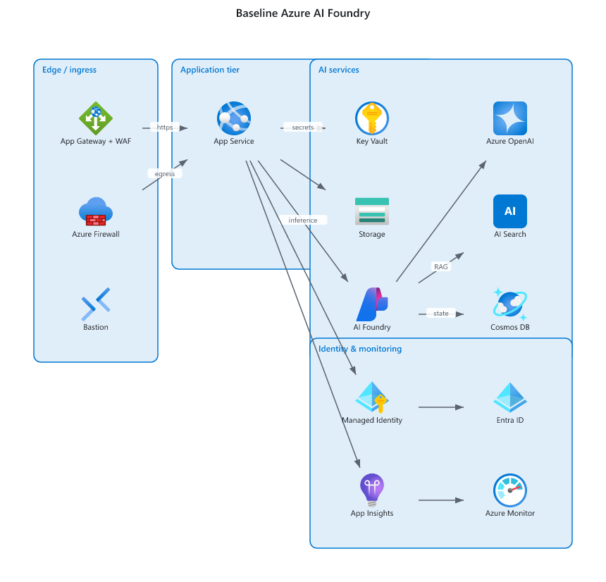
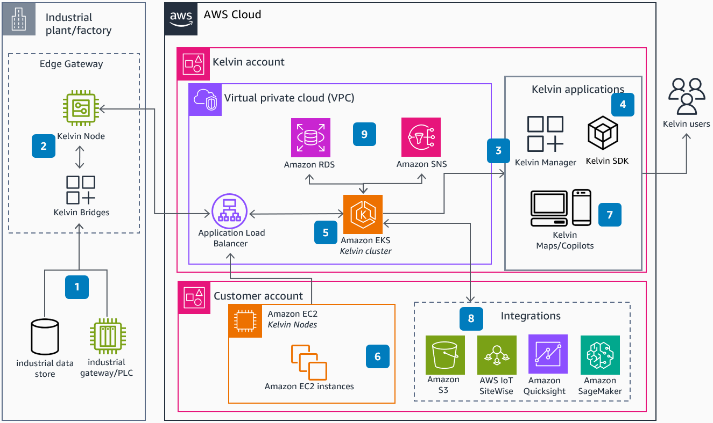
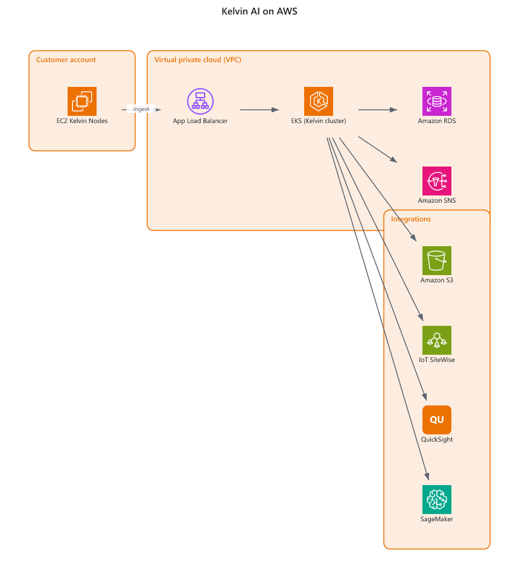
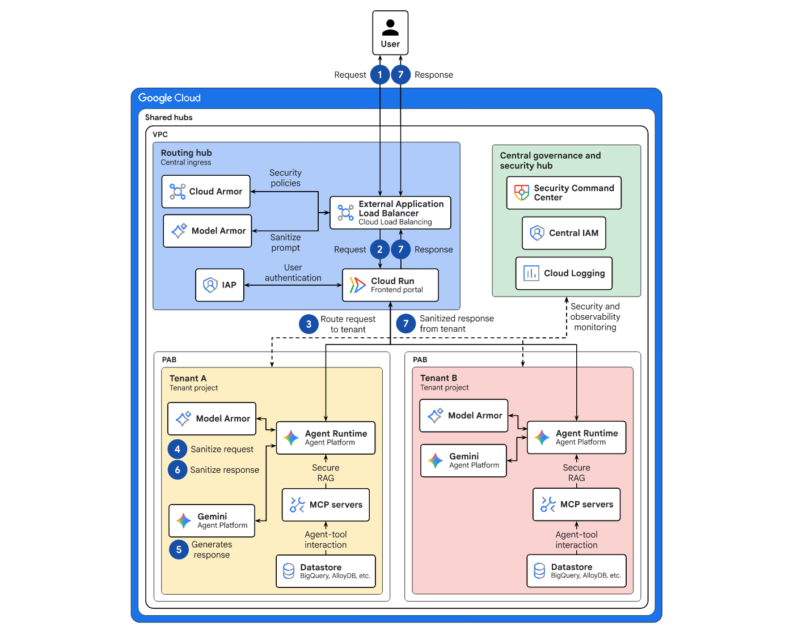
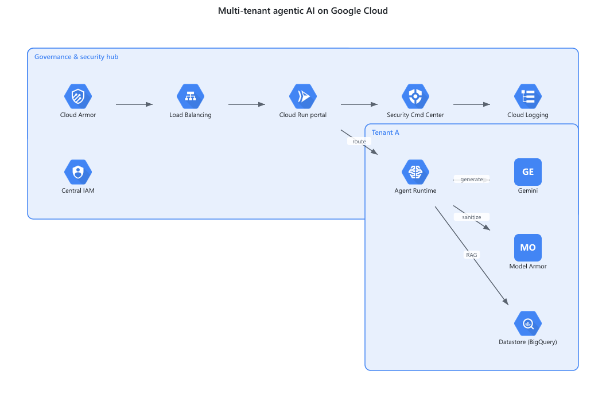

> How I turned "draw me the architecture" into a deterministic, agent-drivable pipeline that emits Lucid-, draw.io-, and Visio-ready diagrams — and the engineering standards I baked into it.

## The problem with most architecture diagrams

Ask a coding agent to "diagram this architecture" and you usually get a Mermaid flowchart of labelled boxes. It's fine for a whiteboard. It is *not* fine for a design review, an RFP response, or an architecture decision record, where the audience expects to see the **actual vendor services** — Azure App Service, AKS, Key Vault, S3, GKE, an EKS cluster — rendered as the icons everyone recognizes.

The other half of the problem is *editability*. A PNG is a dead end. Teams live in Lucidchart, draw.io, and Visio. So the diagram needs to land in those tools as something you can move, relabel, and extend — with the icons intact.

I wanted a single source of truth that a human *or* an AI agent could produce, and a renderer that turns it into all three formats deterministically. So I built `archdiagram` (<https://github.com/bharathgnana/archdiagram>). This document is partly a walkthrough of the tool, and partly a record of the engineering standards I held it to — because for me the second part is the point.

## The core idea: treat architecture as a spec

The input is not a drawing. It's a small, declarative **spec** — architecture-as-code:

```json
{
  "title": "Web platform on Azure",
  "direction": "LR",
  "groups": [{ "id": "app", "label": "Application tier", "vendor": "azure" }],
  "nodes": [
    { "id": "web", "service": "azure.app_service", "label": "Web App", "group": "app" },
    { "id": "aks", "service": "azure.aks",         "label": "AKS",     "group": "app" },
    { "id": "kv",  "service": "azure.key_vault",   "label": "Key Vault" }
  ],
  "edges": [
    { "source": "web", "target": "aks", "label": "api" },
    { "source": "aks", "target": "kv",  "label": "secrets" }
  ]
}
```

`service` is `"<vendor>.<service_key>"`, resolved against a catalog of official vendor icons. Everything else — layout, icon resolution, format conversion — is deterministic and handled by the engine. A spec is diffable, reviewable, and version-controllable. That alone changes architecture diagrams from disposable artifacts into maintained ones.

Then one command renders it:

```bash
python -m archdiagram.cli render spec.json -f pdf    -o out/arch.pdf
python -m archdiagram.cli render spec.json -f drawio -o out/arch.drawio --drawio-mode portable
python -m archdiagram.cli render spec.json -f vsdx   -o out/arch.vsdx
```

{ width=6.0in }

## Constraint #1: a pure-Python, stdlib-only core

The single most important decision was this: **the core engine has zero third-party Python dependencies.** No graphviz, no headless browser, no `jsonschema`, no diagram library.

Why be so strict? Because the environments where architects most need this — regulated enterprises, air-gapped networks, locked-down corporate laptops, education settings — are exactly the ones where `pip install` of a heavy dependency tree is painful or forbidden. A tool that only runs on a fully open machine isn't a tool an architecture function can standardize on.

Concretely, that meant:

- **Hand-rolled spec validation.** Instead of reaching for `jsonschema`, validation is explicit Python that collects *all* errors with precise paths (`nodes[2].service: must be "<vendor>.<service_key>"`) rather than failing on the first one. Better diagnostics, zero dependency.
- **`.vsdx` written with `zipfile` + `xml` from the standard library.** A `.vsdx` is just an OPC package — a ZIP of XML parts plus media. You don't need a Visio SDK; you need to understand the format.
- **Deterministic layered layout, no graphviz.** A longest-path layering pass assigns nodes to columns, a stable ordering keeps group members adjacent, and group containers are computed from member bounds. Same spec in, same coordinates out — every time.

## Constraint #2: optional power, fully isolated

Stdlib-only is a constraint, not a straitjacket. Where extra fidelity genuinely helps, I allowed optional dependencies — but **quarantined** them so the core never takes the hit:

- A small **Node bridge** (`@resvg/resvg-js` for SVG→PNG rasterization, `pdfkit` + `svg-to-pdfkit` for SVG→PDF) lives entirely under `node/` and one Python wrapper. If it's absent, the engine *degrades gracefully*: `.vsdx` falls back to labelled boxes, and `.pdf` fails with a clear install hint rather than a stack trace.
- The **MCP SDK** is allowed in exactly one place — the `mcp_server/` subpackage — and nowhere else.

This is a pattern I reuse across platforms: a minimal, dependency-light core, with capability "wings" that are optional, isolated, and fail safe.

## The hard-won lesson: Lucid doesn't render what you think

My first instinct was to lean on draw.io's named vendor stencils (`mxgraph.aws4.*`) and its `img/lib/...` icon references. They look perfect in draw.io. Then you import into Lucidchart and every icon is blank.

The reality, learned the unglamorous way: **Lucid's importer doesn't map draw.io's named stencils or its asset-host image paths.** So I redesigned the output strategy around what each target can actually honor:

| Format | Strategy | Best for |
|--------|----------|----------|
| `.pdf` | icons **baked in** (rasterized, embedded) | reliable visual fidelity in Lucid; handoff; printing |
| `.drawio` (native) | draw.io's built-in stencils | editing inside draw.io / diagrams.net |
| `.drawio` (portable) | icons **embedded** as base64 data URIs | importing into Lucid while staying editable |
| `.vsdx` | embedded PNG glyphs as OPC media | Visio / Lucid editable import |

The `.drawio` emitter is therefore **dual-mode**, and PDF is the dependable "icons always render" deliverable.

## Fidelity: original vs. generated

The real test is whether a spec, rendered by the engine, reproduces a real-world reference architecture using the *correct* vendor icons. Below, each "original" is a published reference diagram; each "generated" image is produced by `archdiagram` from a hand-written spec of the same architecture — same services, same official icons, now editable and re-exportable.

### Example 1 — Industrial IoT platform on AWS

**Original (published reference):**

{ width=6.0in }

**Generated by archdiagram (from spec):**

{ width=6.0in }

### Example 2 — Multi-tenant agentic AI platform on Google Cloud

**Original (published reference):**

{ width=5.2in }

**Generated by archdiagram (from spec):**

{ width=5.2in }

The generated diagrams use the same official service icons as the originals, grouped into the same tiers — but they are produced from a versionable spec and export cleanly to PDF, draw.io, and VSDX.

## Built to be driven by AI agents

The natural-language → spec step is exactly what an LLM is good at; the spec → pixels step is exactly what it's *bad* at. So `archdiagram` hands each half to the right actor:

- A **skill** (`SKILL.md`) teaches an agent the spec schema, how to look up service IDs in the catalog, and the render commands.
- An **MCP server** exposes the engine as tools — `validate_spec`, `render_diagram`, `search_catalog`, `list_catalog` — so any MCP-capable client can call it directly.

The agent does the translation; the deterministic engine guarantees the output.

## The part I care about most: governance

A public repo is a chance to *show* engineering standards, not just claim them. So `archdiagram` ships with the same rigor I'd expect from a platform team:

- **CI on every push and PR** running a standard-library `unittest` suite (validation, layout, catalog, and emitter structure — verifying, for instance, that the generated `.vsdx` is a well-formed OPC package).
- **Branch protection on `main`**: pull requests required, CI must pass, force-pushes blocked.
- **`CONTRIBUTING.md` and a PR template** encoding the project's bar: stdlib-only core, dependency isolation, no committed icons or generated outputs, graceful degradation.

The tool draws architectures; the repository demonstrates architecture *practice*.

## Standards I codified along the way

1. **Make the artifact a spec, not a drawing.** Diffable, reviewable, regenerable beats hand-placed boxes.
2. **Constrain the core to the lowest-common-denominator runtime.** Stdlib-only isn't purism; it's adoptability.
3. **Isolate optional power and fail safe.** Optional deps belong behind a boundary, with graceful fallback.
4. **Design outputs around what consumers actually honor**, not what looks right in your editor.
5. **Determinism is a feature** the moment artifacts enter version control.
6. **Encode the lessons in the repo** — tests, CONTRIBUTING, CI — so the standard is enforced, not remembered.

## Try it

The project is open source: <https://github.com/bharathgnana/archdiagram>. Clone it, point your AI agent at the skill or the MCP server, describe an architecture, and get back a PDF, a draw.io file, and a VSDX with real vendor icons.
